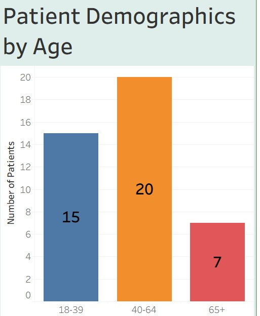
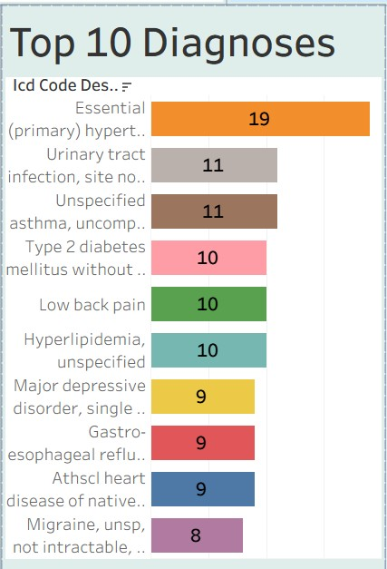
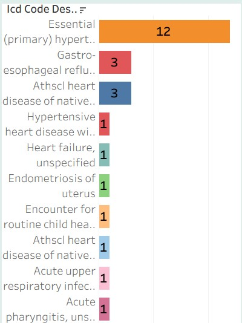
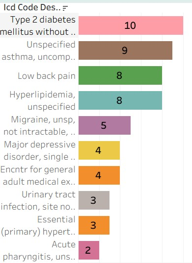
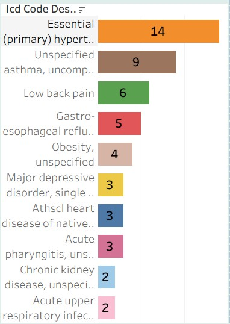
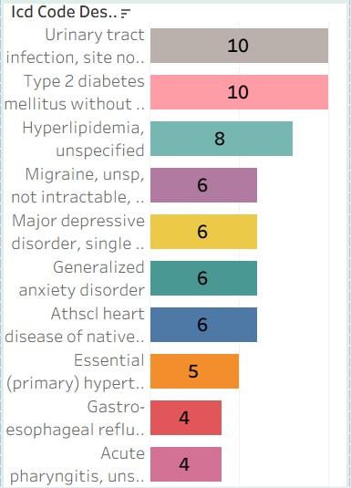
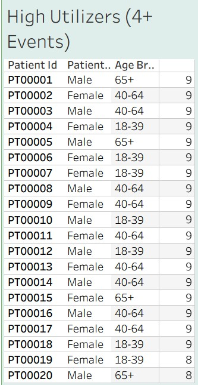
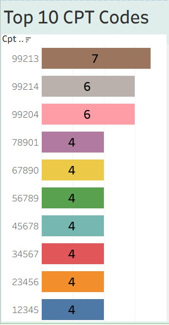

# Diagnosing the Data: An Analysis of Patient Demographics, Common Conditions, and Care Utilization

- [Project Introduction](#project-introduction)
- [:abc: Glossary](#abc-glossary)
- [:dart: Project Goals](#dart-project-goals)
- [:question: Questions to Answer](#question-questions-to-answer)
- [:information\_source: Data Source](#information_source-data-source)
- [:hammer: Tech Stack](#hammer-tech-stack)
- [:broom: Data Cleaning \& Preparation](#broom-data-cleaning--preparation)
- [:microscope: Analysis \& Key Findings](#microscope-analysis--key-findings)
  - [Patient Population Demographics Breakdown](#patient-population-demographics-breakdown)
    - [What this means](#what-this-means)
  - [Top Diagnoses Breakdown](#top-diagnoses-breakdown)
    - [What this means](#what-this-means-1)
  - [High Utilizers](#high-utilizers)
  - [CPT Codes](#cpt-codes)
    - [What this means](#what-this-means-2)
- [:warning: Limitations](#warning-limitations)

## Project Introduction

A mid-size clinic treats patients one at a time, but it also needs to understand the big picture.

It needs to understand patient demographics, most common conditions treated, most frequently performed procedures and patients who have frequent visits.

To answer these questions, I used Python (pandas) and Tableau to clean a **synthetic dataset**, analyze the data and deliver a final dashboard.

With this dashboard, the clinic can understand its patient mix, most common conditions, and heaviest users of care, and use that to decide where to prioritize attention and plan services.

*View the interactive dashboard [:link: here]((https://public.tableau.com/app/profile/jude.isuru.fernando/viz/PatientDataFinalDashboard/FinalDashboard))*

## :abc: Glossary

|Term | Description |
|---|---|
|ICD-10 | International Classification of Diseases, 10th Revision is a standardized alphanumeric system to categorize diseases, symptoms, injuries, and health conditions, published by the World Health Organization (WHO). This dataset uses the US clinical modification. |
| CPT | Current Procedural Terminology is a standardized set of five-character numeric or alphanumeric codes maintained by the American Medical Association (AMA) to standardize how medical, surgical, and diagnostic services and procedures are reported. ICD codes describe diagnoses or reasons for a visit, while CPT codes describe procedures and services performed|
| High Utilizer | A patient with 4+ diagnosis events |
| Synthetic Dataset | Artificially generated data that imitates the structure of real data. It contains no real patient information, so there are no privacy concerns, and the findings do not describe an actual clinic. |
| Diagnosis Event | One row in the dataset is a single diagnosis recorded for a patient, together with the procedure performed. This project counts diagnosis events as “visits,” because the dataset’s visit_id repeats across rows and can’t be used to count visits reliably.|

## :dart: Project Goals

- Understand who the clinic serves

- Identify common diagnoses to plan services accordingly

- Highlight patients who use care most

- Rank procedures by how often they are performed  
  

## :question: Questions to Answer

 - What does the clinic’s patient population look like by age?

- What are the top diagnoses overall?

- Who are the high utilizers?

- Which CPT codes (procedures) are performed most often?
  
## :information_source: Data Source

[:link:Raw Patient Visit Data](Data/patient_visits.csv)

[:link:ICD Codes](Data/icd_codes.csv)

[:link:Processed Data](Exports/CSV/final_patient_visits.csv)

> **Note:** On GitHub, click the link above then click the :arrow_down: **Download** 
> button (or press the download icon) on the top right of the page to save the file.

## :hammer: Tech Stack

- **Python (pandas)** - Data cleaning and preparation

- **VS Code** - Code editor

- **Tableau** - Data analysis, visualization and final dashboard

## :broom: Data Cleaning & Preparation

| Issue/Observation | Action Taken |
|---|---|
| `visit_id` repeating across rows  | Counted each row as one diagnosis event instead of using `visit_id` |
| Dates were stored as text | Converted the date columns to datetime |
| CPT code was stored as a number | Converted the CPT column to text since it is categorical data |
| same `patient_id` had different DOB and sex across rows| Demographics are taken from each patient's first appearance in the file. Dropped the existing age column and re-calculated using DOB. Age is approximated as reference year minus birth year, as of 2024-12-18. It can overstate age by up to one year for patients whose birthday hadn’t yet occurred|
| ICD description not available  | Cleaned `icd_code ` column and joined with an ICD code dataset to extract ICD descriptions  |

## :microscope: Analysis & Key Findings

*Full notebook available in [:link:Data Cleaning & Analysis Notebook](Notebooks/Data%20Cleaning%20and%20Analysis.ipynb)*

*View the interactive dashboard [:link:here](https://public.tableau.com/app/profile/jude.isuru.fernando/viz/PatientDataFinalDashboard/FinalDashboard)*

### Patient Population Demographics Breakdown

Patients were categorized into 4 age brackets. (0-17, 18-39, 40-64 and 65+) 

Since there were no patients below 18 years of age, the 0-17 bracket does not appear in the visualization.

40-64 bracket accounts for close to 50% of the total patient population while 18-39 lags behind with 35%.

#### What this means

Most patients are 40 or older, so the clinic’s services serve mainly adult and older-adult care. With no patients under 18, pediatric services aren’t reflected in this data.

### Top Diagnoses Breakdown

Hypertension is the top diagnosis with 19 diagnosis events while Urinary Tract Infection and Asthma are trailing with 11 events each.

When filtering to the 65+ age bracket, Hypertension remains at the top with 12 diagnosis events while Gastro-esophageal reflux and Atherosclerotic heart disease tie with 3 events each.

For the 40-64 bracket, diabetes and asthma account for the top 2 with 10 and 9 events respectively.

For males, Hypertension and Asthma lead with 14 and 9 diagnosis events respectively. 

UTI and Diabetes tie with 10 events each for females.

#### What this means

Hypertension is the most frequently recorded diagnosis, and it is concentrated in the 65+ band, so it is a natural starting point for service planning.

These counts are diagnosis events, so a few patients with many events can dominate a bar. The age and sex breakdowns suggest patterns and don’t confirm them.

Some diagnoses are dominated by a single sex (UTI mostly in females, hypertension and asthma mostly in males), which suggests sex-specific patterns worth watching.

The groups are small, and sex comes from each patient’s first record, this as a potential lead, not a definitive conclusion.

### High Utilizers

The high utilizers account for approx. 48% of patients (20 out of 42) and 89% of events (178 out of 200)

### CPT Codes

The top CPT code is 99213 with 7 while 99214 and 99204 tie with 6 each.

#### What this means

No single procedure dominates.

With the leading codes appearing only 6 to 7 times out of 200 events, procedure volume is spread thinly across many codes, so the top three shouldn’t be treated as the clinic’s core services.

## :warning: Limitations

 - Synthetic, small dataset. The data covers 42 patients and 200 diagnosis events, so the findings illustrate the analysis and don’t describe a real clinic. The filtered views (by age band or sex) rest on only a handful of patients each.

- Conflicting patient records. Patients with repeated rows had different dates of birth and sexes across those rows. I used each patient’s first record, which is an assumption, so the age band and sex breakdowns could change under a different rule.

- Approximate age. Age is calculated as reference year minus birth year (as of 2024-12-18), so it can be one year too high for some patients.

- Events are not patients. Diagnosis counts are events, and the 20 high utilizers account for 89% of them, so a few patients can dominate a diagnosis.
  
- Visits are diagnosis events. The dataset’s visit_id repeats across rows, so “visits” and the average of 4.762 per patient are counts of diagnosis events, not confirmed clinic visits.

- High utilizers mean frequent use, not high need. The data has no severity or clinical detail, so I can’t say whether these patients are sicker. The sharp split (1 event versus 8 to 9, with nobody in between) looks like an artifact of how the data was generated, and the 4+ cutoff gives the same 20 patients anywhere from 2 to 8.

- Procedure codes are hard to interpret. There’s no CPT description table, so procedures appear only as codes, and the counts are spread thinly across many distinct codes.